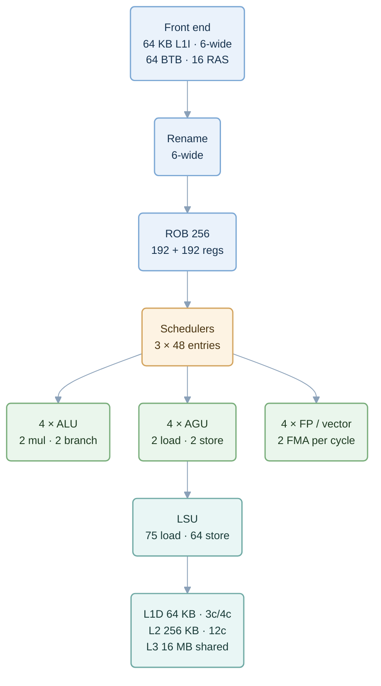
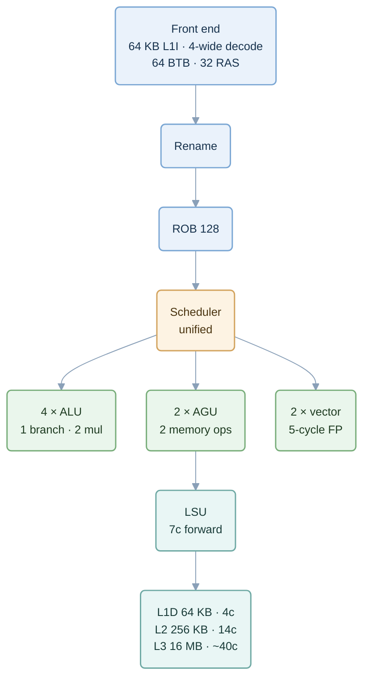

# Processor block diagram

The diagrams below show the two cores at the same level of detail: front end,
rename, out-of-order window, schedulers, execution pipes, and the memory path.
The numbers come from the microbenchmark work published by Chips and Cheese and
LoongPerf, and they describe the core rather than the package. Clock speed, the memory
controller, and the L3 interconnect are left out.

## LA664

LA664 is a 6-wide out-of-order core. The front end fetches from a 64 KB, 4-way
L1I through a 6-wide decoder, steered by a 64-entry L1 BTB, a 16-entry return
stack (8 entries per thread when SMT is active), and an indirect target array
that holds 1024 targets. There is no micro-op cache. A BTB miss appears to
fall back to the instruction cache and the branch address calculator rather than
to a second BTB level, which is why the 64 KB L1I matters more than it does on
cores with a large decoupled BTB.

Rename is 6-wide. The ROB holds 256 entries, backed by 192 integer and 192
vector physical registers. Three schedulers of 48 entries each feed the integer,
memory, and FP/vector pipes.

The integer cluster has four ALUs. Two can execute branches and two can
multiply. Memory has four AGUs, two for loads and two for stores, feeding a
75-entry load queue and a 64-entry store queue. The FP/vector cluster has four
pipes: all four handle 256-bit packed FP adds, and the core can start two FMAs
per cycle.

The L1D is 64 KB and 4-way. Its load-to-use latency is 3 cycles for a pointer
chase and 4 cycles for other dependent integer loads; `fld`, `vld`, and `xvld`
take 5 cycles. It can serve two 256-bit accesses per cycle in any mix of loads
and stores. L2 is 256 KB with a 12-cycle
latency. L3 is 16 MB, shared by the four cores of a cluster.

## LA464

LA464 is a 4-wide core with a 128-entry ROB and no SMT. Its 64 KB, 4-way L1I
feeds a 4-wide front end, with a 64-entry BTB, a 32-entry return stack, and
roughly 512 indirect targets. The L1I hit latency appears to be 3 cycles. The renamer
shows no sign of zeroing or move elimination; what you write is what the
execution pipes see.

Four ALUs handle the integer work. Only one branch can resolve per cycle, and
two integer multiplies can start per cycle with a 4-cycle latency. Integer
division is data-dependent, up to 38 cycles for 64-bit operands. Two AGUs can
issue two loads or one load plus one store. The vector cluster has two 256-bit
pipes. FP add, multiply, and FMA all take 5
cycles, and the core starts two FMAs per cycle.

Store forwarding takes 7 cycles when the load is fully contained in the store,
and 14 cycles on a partial overlap. A misaligned load costs 2 cycles; a
misaligned store costs 10, or 15 when it crosses a 16 KB page. The L1D is 64 KB
and 4-way with a 4-cycle integer load-to-use latency in all cases; `fld`, `vld`,
and `xvld` take 5 cycles. L2 is 256 KB, 16-way, a victim
cache with a 14-cycle latency. L3 is 16 MB with about 40 cycles, shared by four
cores. The L1 DTLB has 64 entries, the L2 TLB 2048, and the default page size is
16 KB.

## What the diagrams leave out

The diagrams stop at the core boundary. On LA664, SMT is part of the picture:
the ROB, register files, and load/store queues are statically partitioned
between the two threads, while the schedulers are watermarked so a thread can
use what appears to be about 30 entries even when its sibling is active. LA464
has no SMT, so none of that applies.

Branch prediction is drawn as one box because its internals are largely
undocumented. The 64-entry L1 BTB and the return stacks are measured; the
direction predictor's structure is not public, and the numbers in the diagram
are the observable capacities, not the vendor's specification.

The diagrams also skip the TLB hierarchy, the L3 interconnect, and the memory
controller. Those belong to the address translation and cache sections, and the
memory controller in particular differs a lot between the two parts: the 3A5000
DDR4 controller was a weak point, and the 3A6000 improved it substantially.

Per-instruction latency and throughput are maintained separately in
[Instruction latency and throughput](../latency-throughput.md). Where the sources
disagree, the measurement wins, and the diagram should be corrected.
