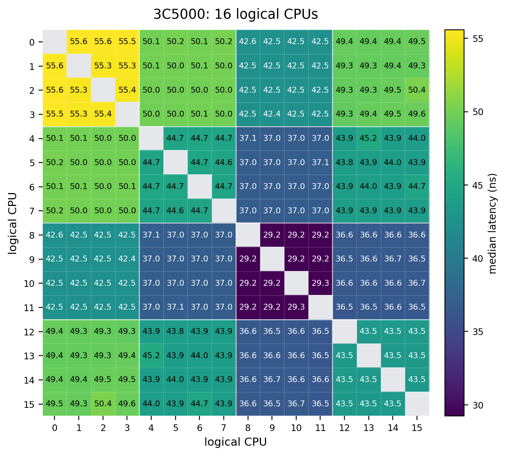

# Core-to-core latency

A cache line that moves between cores costs far more than an L1 hit, and on a
multi-die part the cost depends on which pair of cores is talking. The two
heatmaps below plot measurements from
[nviennot/core-to-core-latency](https://github.com/nviennot/core-to-core-latency)
on a 3C5000 and a 3C6000/S.

The tool reports one-way latency as half the round-trip time, in nanoseconds.
Each cell is the median for one ordered pair and is printed in the heatmap; the
diagonal is omitted. The raw matrices are in
[core-to-core-3C5000.csv](core-to-core-3C5000.csv) and
[core-to-core-3C6000S.csv](core-to-core-3C6000S.csv).

| Part | Logical CPUs | Min | Median | Max |
| --- | --- | --- | --- | --- |
| 3C5000 | 16 | 29.2 | 43.7 | 55.6 |
| 3C6000/S | 32 | 20.1 | 26.3 | 32.3 |

All values are nanoseconds. For the 3C6000/S, the table includes SMT sibling
pairs; excluding them changes the median only slightly, to 26.5 ns.

## 3C5000

The 16 cores span 29 to 56 ns. The matrix is not flat: cores 0 to 3 are
consistently slower to reach than cores 8 to 11, and the four bands of four
cores are visible. Within a band, a pair is not faster than a pair across
bands, so these are not local clusters; the pattern is closer to a fixed offset
per core. The CSV has no topology labels, so the page does not assign the bands
to dies or NUMA nodes. What matters for software is the spread: a line transfer
can cost twice as much depending on which core pair is involved.

## 3C6000/S

The newer part exposes 32 logical CPUs and spans 20 to 32 ns, with a median of
26 ns. It is both faster and more uniform than the 3C5000: the median is about
40% lower, and the worst pair is below the 3C5000 median. The 32 by 32 grid is
dense, so open the image at full size to read the values cell by cell.

The 3C6000/S has SMT, so its 32 logical CPUs are 16 cores with two threads each:
0 and 1 are siblings, 2 and 3 are siblings, and so on. The 16 sibling pairs all
measure 20.7 to 21.1 ns, and they are same-core transfers rather than
core-to-core hops. Excluding them, the median is 26.5 ns. Most cross-core pairs
are 23 to 32 ns, but a small group in the fastest block also reaches 20 to
21 ns, so a low cell is not by itself proof of SMT.

## What this means for software

These are the costs that a synchronization operation pays before any lock
algorithm runs. A contended lock or a cache line bouncing between cores is
limited by the transfer time, not by the atomic instruction's own latency. On
the 3C5000 the spread is large enough that which cores share data matters; on
the 3C6000/S the spread is smaller, but a cross-core handoff is still an order of
magnitude above an L1 hit.

Keep shared mutable data on one core when possible, pad hot per-thread state to
a cache line, and avoid designs that hand a line back and forth between cores.
For the atomic and barrier side of the same problem, see
[Atomics and memory ordering](atomics.md).
