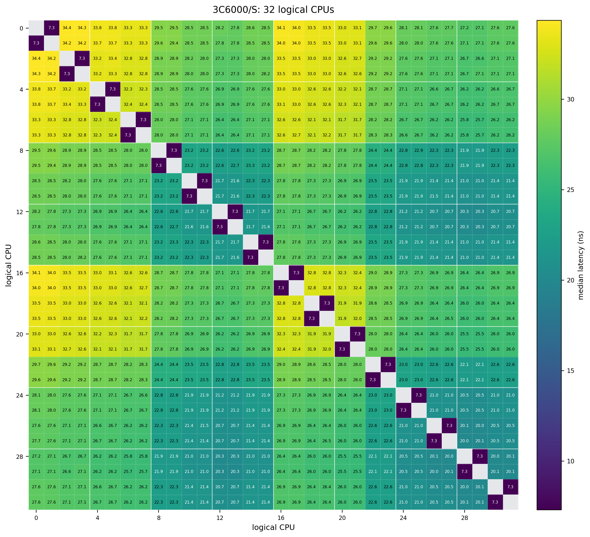

# Core-to-core latency

A cache line that moves between cores costs far more than an L1 hit, and the
cost is not uniform across the cores of a server part. The two heatmaps below
plot measurements from
[nviennot/core-to-core-latency](https://github.com/nviennot/core-to-core-latency)
on a 3C5000 and a 3C6000/S.

The tool reports one-way latency as half the round-trip time, in nanoseconds.
Each cell is the mean for one ordered pair and is printed in the heatmap; the
diagonal is omitted. The raw matrices are in
[core-to-core-3C5000.csv](core-to-core-3C5000.csv) and
[core-to-core-3C6000S.csv](core-to-core-3C6000S.csv).

| Part | Logical CPUs | Min | Median | Max |
| --- | --- | --- | --- | --- |
| 3C5000 | 16 | 29.2 | 43.8 | 55.5 |
| 3C6000/S | 32 | 7.3 | 26.9 | 34.4 |

All values are nanoseconds. The 3C6000/S table includes SMT sibling pairs;
excluding the 16 sibling pairs gives a cross-core median of 26.9 ns.

## 3C5000

The 16 cores span 29 to 56 ns. The matrix is not flat: cores 4 to 7 are
consistently faster to reach than cores 12 to 15, and the four bands of four
cores are visible. All 16 cores are in the same NUMA node and share 32 MB of
L3, so these bands are not NUMA or L3 partition boundaries. Within a band, a
pair is not faster than a pair across bands, so they are not local clusters
either; the pattern is closer to a fixed offset per core. The CSV is a core-by-core matrix, but it does not say which
cores share an L3 group, so the page describes the bands without naming the
clusters. What matters for software is the spread: a line transfer
can cost twice as much depending on which core pair is involved.

## 3C6000/S

The physical machine exposes 32 logical CPUs and spans 7 to 34 ns, with a
median of 27 ns. The low end, 7.3 ns, is SMT sibling traffic, not core-to-core
communication. The rest of the matrix runs from about 20 to 34 ns. This run used
the performance governor; earlier runs on the same machine spanned 7 to 61 ns
and 7 to 112 ns, with several sibling outliers.

The matrix is not uniform, and the 32 by 32 grid is dense, so open the image at
full size to read the values cell by cell. The CSV is a core-by-core matrix, but
it does not say which cores share a cluster or a NUMA node, so the page does not
assign the high-latency pairs to a particular hardware boundary.

The 3C6000/S has SMT: 0 and 1 are siblings, 2 and 3 are siblings, and so on.
All 16 sibling pairs measure 7.3 ns in this run. Earlier runs with the default
governor put some of them at 20 to 39 ns; those were frequency or scheduling
artifacts rather than a property of the cores. Excluding all sibling pairs, the
cross-core median is 26.9 ns.

## What this means for software

These are the costs that a synchronization operation pays before any lock
algorithm runs. A contended lock or a cache line bouncing between cores is
limited by the transfer time, not by the atomic instruction's own latency. On
the 3C5000 the spread is large enough that which cores share data matters; on
the 3C6000/S the spread is smaller, but a cross-core handoff is still an order of
magnitude above an L1 hit.

Keep shared mutable data on one core when possible, pad hot per-thread state to
a cache line, and avoid designs that hand a line back and forth between cores.
For the atomic and barrier side of the same problem, see
[Atomics and memory ordering](atomics.md).
